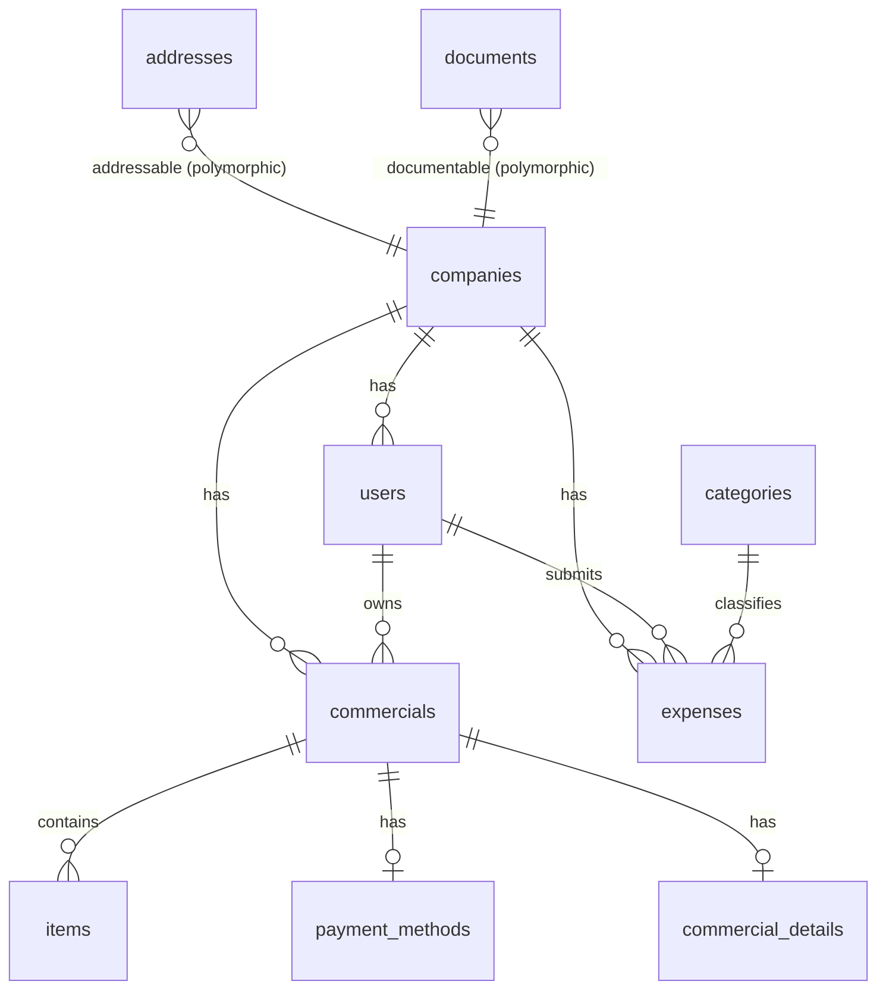

# SIC

SIC is a multi-tenant Ruby on Rails 8 back office. Each **company** has its own users, and the main module is **Finance → Invoices**. The code base started as a copy of the *Ideo Groupe* field-services platform (planning, interventions, quotes, subcontractors). Most of that code was removed in May 2025, and what remains is the starting point for SIC. The Rails module, session cookie and page titles are still named `Ideo`.

> **Status: work in progress.** The cleanup commits (`code cleaning`, `preparation`) deleted many controllers, models and migrations, but the routes, the remaining models, the seeds and the specs still refer to them. The app does not run end to end yet. See [Known issues](#known-issues) before you try to run it.

---

## Table of contents

- [Tech stack](#tech-stack)
- [Architecture](#architecture)
- [Data model](#data-model)
- [Features and routes](#features-and-routes)
- [Mobile API](#mobile-api)
- [Project structure](#project-structure)
- [Getting started (local)](#getting-started-local)
- [Running with Docker](#running-with-docker)
- [Environment variables](#environment-variables)
- [Testing and linting](#testing-and-linting)
- [Development tools](#development-tools)
- [Known issues](#known-issues)

---

## Tech stack

| Layer | Technology |
|---|---|
| Language / framework | Ruby 3.2.2, Rails 8.0 |
| Database | PostgreSQL 16 (extensions: `uuid-ossp`, `unaccent`) |
| Web server | Puma |
| Authentication | Devise (web sessions) + a custom token for the mobile API |
| Authorization | CanCanCan, plus role checks in controllers |
| Front end | Hotwire (Turbo + Stimulus), Turbolinks, jQuery, Rails UJS |
| JS / CSS build | esbuild (`jsbundling-rails`), Sass + PostCSS/Autoprefixer (`cssbundling-rails`), Bootstrap 5 |
| UI libraries | Tom Select, Flatpickr, Trix, SortableJS, SweetAlert2, Dropzone |
| Search / pagination | Ransack, will_paginate, Pagy |
| Presentation | Draper decorators, ActiveModel::Serializers (API), Jbuilder |
| Files / images | Active Storage (local disk), image_processing (ImageMagick / libvips) |
| PDF | wicked_pdf + wkhtmltopdf-binary |
| Geocoding | Geocoder |
| Real time | Action Cable on Redis (no channels yet) |
| Monitoring | Sentry (production only) |
| Deployment | Docker Compose: Postgres, app, Nginx, Certbot (Let's Encrypt) |

The default locale is **French** (`config.i18n.default_locale = :fr`). The UI mixes French and English labels.

---

## Architecture

### Multi-tenancy

- `Company` is the tenant. Users, quotes/invoices, expenses and other business records carry a `company_id`.
- `Current.company` (`app/models/current.rb`, an `ActiveSupport::CurrentAttributes`) holds the active company for the request. `ApplicationController#set_current_company` sets it:
  - for a normal user, it is `current_user.company`;
  - for a **superadmin**, it is the company stored in `session[:company_id]`. A superadmin picks one from *Agences* (`/companies/:id/switch-company`) and goes back to the global view with `/companies/switch-global`.
- The `CompanyScoped` concern (`app/models/concerns/company_scoped.rb`) adds a `current_company` scope (`where(company: Current.company)`) and fills in `company` before validation.
- `ChecksCompany` (`app/controllers/concerns/checks_company.rb`) redirects users who have no company.

### Users and roles

- `User` uses Devise and has single-table-inheritance subclasses: `Admin`, `Agent` and `Superadmin`.
- `role` enum: `supervisor, agent, punctual, regular, finishing, extern, admin, subcontractor, superadmin`.
- `platform` enum: `web, mobile`.
- **Web sign-in** (`Web::Users::SessionsController`) only accepts **active** users whose type is `Superadmin`, `Admin` or `Subcontractor`.
- **Layouts**:
  - `superadmin_layout` for a superadmin with no company selected;
  - `admin_layout` for admins, and for superadmins who have selected a company;
  - `application` for everyone else.
- `Web::ApplicationController` is the base class for the admin area. It requires a company and an admin or superadmin user.

### Request handling

- **Web** controllers live under `app/controllers/web/` (Ruby module `Web::`, mounted with `scope module: :web`, so the URL has no `/web` prefix).
- **API** controllers live under `app/controllers/api/v1/` and use token authentication (see [Mobile API](#mobile-api)).
- Most pages update in place with **Turbo Streams**:
  - modals render into the `remote_modal` turbo frame in the layout;
  - flash messages are swapped in through `FlashMessageService` (`app/services/flash_message_service.rb`).
- Front-end behaviour is in Stimulus controllers (`app/javascript/controllers/`) and small service modules (`app/javascript/services/`) for HTTP, modals, maps, Trix and SweetAlert.

### Invoice / quote workflow

`Commercial` is the base model for commercial documents. It is single-table-inheritance on the `commercials` table, and `Quote` is the subclass in use. A quote has:

- `items`: line items with unit price, quantity, unit, days and a discount in currency or percent;
- one `payment_method`: payment mode `cheque / transfer_bank / cash`, due dates and the amount paid;
- one `commercial_detail`: about 16 `display_*` flags that control which columns and sections appear on the PDF;
- one `address` (polymorphic), and contacts through `commercial_contacts`.

The editor is a 3-step wizard (`_steps.html.erb`):

1. client information;
2. mission information;
3. line items (*prestations*).

Other parts of the workflow:

- `Quote#generate_reference` builds the next reference number from the company's prefix pattern. The pattern can contain `(AA)`, `(aaaa)`, `(annee)` and `(mois)`.
- A quote can be saved as a **template**. New quotes can then be created from it with `new-from-model/:source_id`. *Settings → quotes_model* lists the templates.
- `GET /finances/quotes/:id/pdf` renders `web/finances/quotes/pdf.html.erb` to PDF with wicked_pdf.
- `QuoteDecorator` renders the status badges in the list.

---

## Data model

These are the tables the **migrations** in `db/migrate/` create. `db/schema.rb` is out of date and does not match them (see [Known issues](#known-issues)).



| Table | Purpose | Notable columns |
|---|---|---|
| `companies` | Tenant | `legal_name`, `tax_id`, `email`, `tel`, `iban`, `bic`, `tva_rate`; logo stored with Active Storage |
| `users` | Devise accounts | `company_id` (NOT NULL), `first_name`, `last_name`, `role`, `platform`, `active`, `authentication_token`, last known GPS position |
| `addresses` | Polymorphic address | street, postal code, city, `country` (default `Tunisia`), lat/long, `geocoder_value` (jsonb) |
| `documents` | Polymorphic uploaded document | `document_type` (kbis, insurance, tax/URSSAF certificates, ID…), `document_status` (pending/accepted/refused/expired), `expiration_date`; file stored with Active Storage |
| `commercials` | Invoice / quote header | `user_id`, `company_id`, `extracted_data` (jsonb) |
| `items` | Invoice line | `unit_price`, `quantity`, `unit`, `days`, `order`, `reduction`, `reduction_unit` |
| `payment_methods` | Payment terms and status | `payment_mode`, `deadline_regle`, `delai_regle`, `paid_amount`, `paid_amount_date`, `payment_status` |
| `categories` | Expense category | `name` |
| `expenses` | Expense entry | `user_id`, `company_id`, `category_id`, `amount`, `status` |
| `active_storage_*` | Rails file attachments | |

The `commercial_details` model exists, but no current migration creates its table. It is still in the old `schema.rb`.

---

## Features and routes

Everything is defined in `config/routes.rb`. Many routes still point to controllers that were deleted in the cleanup. This table shows what exists today.

| Area | URL prefix | Controller present? |
|---|---|---|
| Login / logout | `/login`, `/logout` | ✅ `Web::Users::SessionsController` |
| Profile | `/profile/edit` | ✅ `Web::Users::ProfileController` |
| Superadmin: companies ("Agences") and switching | `/companies` | ✅ |
| Superadmin: administrators | `/administrators` | ✅ |
| Finance: invoices / quotes | `/finances/quotes` | ✅ (several views are missing: `new`, `edit_informations`, `edit_prestations`) |
| Finance: service catalogue picker | `/finances/prestations` | ✅ `CommercialsController` |
| Settings: users (agents / administrators) | `/settings/users` | ✅ |
| Settings: clients ("Groupes") | `/settings/clients` | ✅ |
| Settings: quote templates | `/settings/quotes_model` | ✅ |
| Settings: home page | `/settings` | ✅ (placeholder) |
| Task boards (kanban) | `/boards/...` | ❌ only an empty `ColumnItemsController` |
| Plannings, needs, absences | `/plannings`, `/needs`, `/absences` | ❌ removed |
| Bills, interventions | `/finances/bills`, `/finances/interventions` | ❌ removed |
| Settings: companies, skills, regions, prestations, subcontractors, contacts, email models, legal mentions, headings | `/settings/...` | ❌ removed |

Sidebar for admins (`app/views/layouts/_sidebar.html.erb`):

- **Dashboard** (placeholder)
- **Task Management**
- **Finance → Invoices**
- **Configuration**: Entreprise, Users, Groupes

---

## Mobile API

Namespace: `/api/v1`. The token is sent either as `Authorization: Bearer <token>` or as the `authentication_token` parameter.

| Method | Path | Description |
|---|---|---|
| `POST` | `/api/v1/login` | Body: `email`, `password`. Returns `{ authentication_token, user }`. A new token is generated on each login. |
| `DELETE` | `/api/v1/logout` | Clears the user's token. |
| `GET` | `/api/v1/user/:id` | Route exists, but it maps to `Api::V1::UserController`, which does not exist. The controller that does exist is `Api::V1::UsersController`, and it is not routed. |
| `GET` | `/api/v1/absences` | Route exists; the controller was removed. |

---

## Project structure

```
app/
  controllers/
    api/v1/            Token-authenticated JSON API
    web/               Back office (finances/, settings/, superadmin/, users/)
    concerns/          ChecksCompany
  models/              Company, User (+ Admin/Agent/Superadmin), Commercial (+ Quote),
                       Item, PaymentMethod, CommercialDetail, Address, Document,
                       Category, Expense, Current, concerns/CompanyScoped
  decorators/          QuoteDecorator (Draper)
  serializers/         API serializers
  services/            FlashMessageService
  queries/helpers/     InterventionQueryHelper (refers to a removed model)
  views/
    layouts/           application, admin_layout, superadmin_layout, sidebar, header
    web/finances/quotes/   Invoice list, wizard partials, PDF template
    web/settings/          Users, clients, companies forms
  javascript/          esbuild entry points, Stimulus controllers, services
  assets/stylesheets/  Sass (Bootstrap 5 + components/views)
config/                Rails config; routes.rb; locales (fr, en)
db/migrate/            Migrations (the source of truth for the current model)
spec/                  RSpec suite (models, controllers, requests, helpers, factories)
nginx/nginx.conf       Reverse proxy + TLS for the Docker deployment
certbot/               Let's Encrypt data used by the nginx container
Dockerfile, docker-compose.yml, entrypoint.sh
Procfile.dev, bin/dev  Local dev process manager (foreman)
```

---

## Getting started (local)

### Prerequisites

- Ruby **3.2.2** (`.ruby-version`)
- Node.js **22.x** (`.node-version`) and Yarn
- PostgreSQL 16
- Redis (the Action Cable development adapter in `config/cable.yml` uses it)
- ImageMagick or libvips (for Active Storage image variants)

### Setup

```bash
bundle install
yarn install
```

`config/database.yml` connects as `postgres` / `password` to `sic_development` and `sic_test`. Change these values to match your local Postgres. The file has no `production` section, so production uses `DATABASE_URL`.

```bash
bin/rails db:create db:migrate
bin/rails db:seed          # currently fails, see Known issues
```

### Run

```bash
bin/dev
```

`bin/dev` uses foreman to start the three processes in `Procfile.dev`:

- `web`: `bin/rails server` on port 3000
- `js`: `yarn build --watch` (esbuild → `app/assets/builds/`)
- `css`: `yarn watch:css` (Sass + Autoprefixer → `app/assets/builds/application.css`)

Open <http://localhost:3000>. `*.lvh.me` hosts are also allowed in development.

### Seed accounts

When the seeds work, they create these accounts (password `password`):

| Email | Type |
|---|---|
| `superadmin@example.com` | Superadmin |
| `ideo@example.com` | Admin of *Ideo Groupe* |
| `test@example.com` | Admin of *Test Company* |

They also create about 40 random admins and agents.

---

## Running with Docker

`docker-compose.yml` defines four services:

| Service | Description |
|---|---|
| `db` | `postgres:16.3`, with data kept in the `db_data` volume, port 5432 |
| `app` | Built from `Dockerfile` with `RAILS_ENV=production`, port 3000 |
| `nginx` | Reverse proxy on ports 80/443 with the Let's Encrypt certificate for `demo.ssp-protection.fr` |
| `certbot` | Gets and renews that certificate |

When the `app` container starts, `entrypoint.sh`:

1. loads `.env`;
2. precompiles assets;
3. runs `db:migrate` and `db:seed`;
4. starts Puma.

The script uses `set -e`, so the container stops if any step fails, including the seeds.

1. Create a `.env` file in the project root:

   ```env
   POSTGRES_DB=sic
   POSTGRES_USER=sic
   POSTGRES_PASSWORD=change-me
   SECRET_KEY_BASE=<output of `bin/rails secret`>
   DATABASE_URL=postgresql://sic:change-me@db:5432/sic
   ```

2. Start the app and the database. Leave out `nginx` and `certbot` unless you are deploying to the demo domain:

   ```bash
   docker compose up --build db app
   ```

3. Open <http://localhost:3000>.

`backend.conf` is an older, unused Nginx config for a different domain.

---

## Environment variables

| Variable | Used by | Purpose |
|---|---|---|
| `SECRET_KEY_BASE` | Rails (production), Docker build | Session and cookie signing |
| `DATABASE_URL` | Rails (production) | Database connection (`database.yml` has no production entry) |
| `POSTGRES_DB`, `POSTGRES_USER`, `POSTGRES_PASSWORD` | `db` container | Database bootstrap |
| `REDIS_URL` | Action Cable (production) | Defaults to `redis://localhost:6379/1` |
| `APP_DOMAIN` | `config.domain` | Falls back to `credentials.domain` |
| `RAILS_MAX_THREADS`, `RAILS_MIN_THREADS`, `WEB_CONCURRENCY`, `PORT` | Puma | Server tuning |
| `RAILS_LOG_LEVEL` | Production logger | Defaults to `info` |

---

## Testing and linting

```bash
bundle exec rspec          # RSpec + FactoryBot + shoulda-matchers + DatabaseCleaner
bundle exec standardrb     # Ruby style (Standard)
```

- SimpleCov writes coverage to `coverage/rspec/`.
- The `test/` directory only holds the empty Rails Minitest scaffold. The real tests are in `spec/`.
- Many specs and factories still cover models that were removed (plannings, absences, subcontractors, skills…), so the suite does not pass yet.

---

## Development tools

- **letter_opener_web**: emails sent in development appear at `/letter_opener`.
- **Bullet**: reports N+1 queries in the log, the browser console and a page footer.
- **hotwire-livereload**: reloads the browser when views or assets change.
- **web-console**, **byebug**, **pry**, **debug**.
- **stackprof**: profiling.

---

## Known issues

This list comes from reading the code after the May 2025 cleanup. Use it as the to-do list for getting the app to boot again.

**Database**

- [ ] `db/schema.rb` (version `2025_03_05_152250`) does not match the migrations:
  - `users.company_id` is missing;
  - `documents`, `categories` and `expenses` are missing;
  - `commercials` has old columns.

  `db:prepare` and `db:schema:load` use the schema file, and `db:migrate` uses the migrations, so they produce different databases. Regenerate the schema after fixing the migrations.
- [ ] `users` has no `type` column, but the app relies on single-table inheritance (`Admin`, `Agent`, `Superadmin`). `SessionsController#create` and the header call `user.type`, so **web login fails**.
- [ ] The `commercials` migration only has `user_id`, `company_id` and `extracted_data`. `Quote` also needs `type`, `reference`, `state`, `client_id`, `created_by`, `is_template`, `template_id`, `template_name`, `validate_date` and others. No migration creates `commercial_details`.
- [ ] `Company` code reads `social_reason`, `prefix_quote` and `taux_tva`, but the table has `legal_name` and `tva_rate`. `CompanyScoped#set_company` calls `Company.current`, which is not defined.

**Seeds**

- [ ] `db/seeds.rb` creates a superadmin without a company, which breaks the `NOT NULL company_id` constraint. It also uses the removed models `Client`, `Intervention` and `Prestation`. Because of this, `db:seed` fails, and so does the Docker `entrypoint.sh`.

**Code that refers to removed classes and views**

- [ ] Removed models are still referenced:
  - `Client`, `Contact`, `Prestation`, `Intervention`, `Heading`, `Skill`, `UserSkill`, `Absence`, `Board` in `Commercial`, `Quote`, `User`, `Agent`, `Company` and several controllers;
  - `InterventionQueryHelper` is built entirely on `Intervention`.
- [ ] `app/models/ability.rb` was deleted, but `Web::Superadmin::CompaniesController` calls `load_and_authorize_resource` (CanCanCan) and `ApplicationController` rescues `CanCan::AccessDenied`.
- [ ] Many routes point to controllers that no longer exist (see [Features and routes](#features-and-routes)). The sidebar links to `boards_path`, `edit_settings_company_path` and the settings sidebar links to removed sections.
- [ ] The quote wizard is missing the `new`, `edit_informations` and `edit_prestations` views, and the `_item_template` partial.

**Mobile API**

- [ ] `resources :user` routes to `Api::V1::UserController`, but the existing class is `Api::V1::UsersController`.
- [ ] `Api::V1::ApplicationController` and `Api::V1::BaseController` contain the same token-authentication code.

**Repository hygiene**

- [ ] There is no `.gitignore`, so `node_modules/`, `tmp/`, `log/`, `storage/`, `coverage/` and `config/.env` are committed.
- [ ] The Let's Encrypt account keys and the TLS private key in `certbot/conf/` are committed. Remove them from git and reissue the certificate.
- [ ] The Sentry DSN is hard-coded in `config/initializers/sentry.rb`. Move it to an environment variable or to the credentials file.
- [ ] Turbo and Turbolinks are both loaded in `app/javascript/application.js`, and the Stimulus `Application` is started twice. Keep only one of each.
